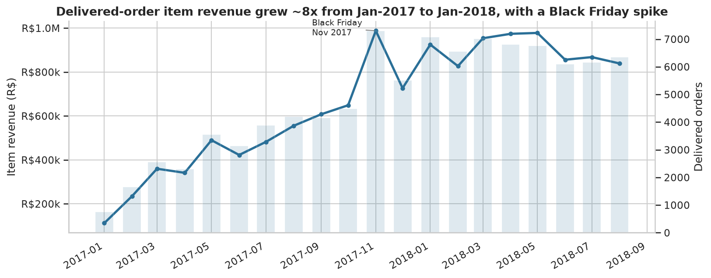

# E-Commerce Sales & Customer Analytics (Olist)

End-to-end analysis of **~100k Brazilian e-commerce orders (2016–2018)**: data cleaning, SQL, EDA, statistical testing and business recommendations — plus two optional extensions (a late-delivery prediction prototype and a simulated A/B test).

**Stack:** Python · Pandas · NumPy · SQL (SQLite; PostgreSQL-portable) · Matplotlib · Seaborn · SciPy · statsmodels · scikit-learn



## Business questions
1. How does revenue change month to month?
2. Which categories drive revenue and volume?
3. What is the average order value, and how skewed is it?
4. Which states/cities contribute the most?
5. What share of customers buy more than once?
6. How do review scores vary with delivery delays?
7. Which payment types are used, and what are typical values?
8. What proportion of orders are delivered vs canceled/other?

## Key findings
*All numbers below come from the executed notebooks/SQL in this repo. "Delivered" = `order_status='delivered'` with a delivery date (96,470 orders). Item revenue = Σ price, excluding freight (R$13.22M).*

| # | Observation | Evidence | Interpretation → Recommendation | Limitation |
|---|---|---|---|---|
| 1 | **Growth stalled in 2018** | Monthly item revenue rose 8.3× Jan-17 → Jan-18 (R$112k → R$925k), then was flat/slightly down: Mar → Aug 2018 −12%. Black Friday Nov-17 was +52% vs Oct, followed by −26% in Dec. | Acquisition-led growth levelled off (hypothesis). Test new channels / retention levers; plan capacity for Nov. | Dataset ends Aug-18; no marketing-spend data to explain why. |
| 2 | **Late delivery is the biggest controllable driver of bad reviews** | 8.1% of orders are late but they generate **34% of all 1–2★ reviews**. Mean score 2.57★ late vs 4.29★ on-time (diff −1.73, 95% CI −1.77…−1.69; Cohen's d −1.45). 7+ days late → 1.73★. | Prioritise fixing delay *spikes*: late rate hit 14% (Nov-17), 16% (Feb-18), **21% (Mar-18)** vs ~1–8% in calmer months. Surge capacity planning + proactive delay notifications. | Observational — distance/seller/category could confound. |
| 3 | **Delivery promises are very conservative** | Median promised 23 days vs median actual 10.2 days. | Tighter, honest estimates could lift conversion — but would raise the late rate; test carefully (A/B). | Estimate formula unknown. |
| 4 | **Demand is geographically concentrated** | SP = 38% of revenue; SP+RJ+MG = 63%. Remote states (PB, AL, PA, PI) have the highest order values (R$178–218 vs R$125 in SP) on few orders. | Distance/freight likely suppresses small orders outside the south-east → regional free-shipping thresholds are worth testing. | Customer location only; no logistics cost data. |
| 5 | **Average order value overstates a typical order** | Mean item value R$137 vs median R$86.5 (skew 9.9); top 10% of orders = 41% of revenue. | Report medians next to AOV; segment high-value baskets for retention. | Item value excludes freight (AOV incl. freight: R$160). |
| 6 | **Customers rarely come back** | Only **3.0%** of 93,350 customers placed 2+ delivered orders; they are 5.5% of revenue. First-purchase-quarter repeat rate falls from 4.9% (2017-Q1) to 1.6% (2018-Q2; later cohorts partly right-censored). Average gap between 1st and 2nd order ≈ 81 days. | Retention is the largest untapped lever; test post-purchase email/voucher timed around day 30–60. | Only 2 years of history, and only `customer_unique_id` linking. |
| 7 | **Freight is a heavy tax on bulky categories** | Freight = 14.3% of GMV overall but 22.8% for electronics, 20.0% office furniture, 19.1% furniture & décor. | Free-shipping thresholds / seller-side shipping subsidies for these categories. | Doesn't prove freight causes lost sales. |
| 8 | **Revenue is spread across many categories; volume ≠ value** | Top 10 categories = 62% of revenue; 18 of 74 categories reach 80%. `bed_bath_table` is #1 by units (10.9k) but #3 by revenue; `watches_gifts` is #2 by revenue on 5.9k units (R$199 avg price). | Merchandise by both revenue and volume; don't over-index on a single hero category. | |
| 9 | **Payments: credit card dominates, instalments common** | Card used on 77% of orders, boleto 20%; 66.9% of card payments use >1 instalment. Payment type explains **<1%** of order-value variance (ε² = 0.009) despite significant differences (median card R$109, boleto R$94, debit R$90, voucher R$81). | Keep instalment options prominent; payment type is not a useful lever for order value. | Customers choose payment after choosing items — not causal. |

## Statistical analysis (notebook 05)
| Test | Question | Method | Result |
|---|---|---|---|
| Investigation 1 | Late vs on-time review scores | Welch t-test + Mann–Whitney U + bootstrap CI | n = 7,661 late / 88,163 on-time; diff −1.73★; Cohen's d −1.45; P(late > on-time) = 22%; **large effect, reject H₀** |
| Investigation 2 | Payment value by payment type | Kruskal–Wallis (primary), log-ANOVA, Holm-corrected pairwise Mann–Whitney | H = 886, p ≈ 10⁻¹⁹²; all 6 pairs differ; **but ε² = 0.009 → tiny practical effect** |

Descriptive statistics (mean/median/SD/variance/IQR/skew/kurtosis/outlier share), assumption checks (Levene, skew, log transforms) and Spearman correlations are in the notebook.

## Optional extensions
- **Late-delivery prediction (notebook 06):** time-based split, no leakage, baselines first. Result is *modest*: ROC-AUC ≈ 0.70, PR-AUC 0.17 vs 0.09 no-skill; top-10% riskiest orders capture 24% of late orders (2.4× lift). Gradient boosting did not beat logistic regression — most lateness arises after checkout.
- **A/B test (notebook 07):** clearly labelled **simulated** data (Olist is observational). Demonstrates power analysis, SRM check, z-test, CI and practical significance; the run is deliberately borderline and under-powered.

## SQL (20 queries — see [`sql/`](sql/) and [`reports/sql_results.md`](reports/sql_results.md))
Joins across 3–4 tables, GROUP BY/HAVING, chained CTEs, subqueries, CASE, and window functions (`ROW_NUMBER`, `RANK`, `DENSE_RANK`, `LAG`, running totals, share-of-total). Includes MoM growth, Pareto concentration, cohort retention, seller leaderboard, per-state top category and a payment reconciliation. SQL and pandas independently agree on delivered revenue (R$13.22M).

## Data-quality highlights (notebook 02)
- Joining `order_items` to `payments` naively **inflates revenue by 4.5%** → every table is aggregated to one row per order *before* joining.
- `customer_id` is per-order → customer analysis uses `customer_unique_id`.
- 789 duplicated `review_id`s / 547 orders with >1 review → keep latest review.
- 2016 and Sep–Oct 2018 are tiny partial months → trends use 2017-01…2018-08.
- 99.75% of orders reconcile (payments ≈ items + freight, ±R$1).
- Outliers inspected and **kept** (valid high-value orders).

## Repository structure
```
├── data/README.md               # how to download the dataset (raw files git-ignored)
├── notebooks/                   # 01 exploration · 02 cleaning · 03 sales · 04 customers/delivery/reviews/payments
│                                # 05 statistics · 06 late-delivery model · 07 A/B simulation  (all executed)
├── sql/                         # schema.sql · analysis_queries.sql · README (PostgreSQL port notes)
├── src/                         # olist.py (shared cleaning), build_db.py, run_sql.py
├── visualizations/              # 21 PNG charts
├── reports/                     # sql_results.md + per-query CSVs
├── PROJECT_REPORT.md            # what was built, decisions, deviations from the brief
├── requirements.txt · run_all.sh
```

## Reproduce
```bash
python -m venv .venv && source .venv/bin/activate
pip install -r requirements.txt
# put the 9 Olist CSVs in data/ (see data/README.md)
./run_all.sh
```

## Limitations
Observational data — associations, not causation · no marketing-spend, margin or cost data · 2016 & late-2018 coverage is partial · one marketplace in one country · reviews are self-selected.

## Dataset & licence
[Olist Brazilian E-Commerce Public Dataset](https://www.kaggle.com/datasets/olistbr/brazilian-ecommerce) — CC BY-NC-SA 4.0. Use for non-commercial/learning purposes with attribution.
